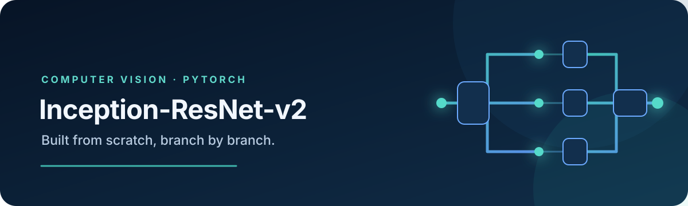

# Inception-ResNet-v2 in PyTorch

<p align="center">
  
</p>

An educational, from-scratch PyTorch implementation of **Inception-ResNet-v2** for image classification. It includes the convolutional stem, Inception-ResNet A/B/C blocks, reduction modules, a configurable classifier head, a Caltech-256 training pipeline, TensorBoard logging, checkpointing, and `torch.export` support.

> The model is initialized from random weights; it does not load pretrained weights. No benchmark accuracy is claimed by this repository.

## Architecture

The network accepts RGB images of shape `B × 3 × 299 × 299`. Its main stages are:

| Stage | Repetitions | Output shape |
|---|---:|---:|
| Convolutional stem | 1 | `B × 384 × 34 × 34` |
| Inception-ResNet-A | 5 | `B × 384 × 34 × 34` |
| Reduction-A | 1 | `B × 1152 × 16 × 16` |
| Inception-ResNet-B | 10 | `B × 1152 × 16 × 16` |
| Reduction-B | 1 | `B × 2144 × 8 × 8` |
| Inception-ResNet-C | 5 | `B × 2144 × 8 × 8` |
| Global average pool + classifier | 1 | `B × num_classes` |

Residual branches use a linear projection and a `0.1` scale before addition. The A block uses three branches with 32, 32, and 64 output channels. These choices follow the paper's residual-scaling guidance and Inception-ResNet-v2 block layout. The classifier is adapted for the configured task: global average pooling, dropout, two hidden fully connected layers (1024 and 512 units), and a logits layer. The output is raw logits, as expected by `CrossEntropyLoss`.

The implementation follows the architecture described in [Inception-v4, Inception-ResNet and the Impact of Residual Connections on Learning](https://arxiv.org/abs/1602.07261). The final classifier and training recipe here are project-specific.

## Requirements

- Python 3.10+
- PyTorch 2.1+ and a compatible torchvision build
- A CUDA GPU is recommended. The full model is compute- and memory-intensive; reduce the batch size if you run out of memory.

Install the listed dependencies in a virtual environment:

```bash
python -m venv .venv
# Windows PowerShell
.venv\Scripts\Activate.ps1
# macOS / Linux: source .venv/bin/activate
python -m pip install -r requirements.txt
```

## Train

The default configuration downloads Caltech-256 into `./data`, makes a seeded random 80/20 train-validation split, and trains a 257-class classifier. Images are resized and center-cropped to 299 × 299, normalized with ImageNet mean and standard deviation, and randomly flipped horizontally during training.

```bash
python train.py
```

Common overrides:

```bash
python train.py --epochs 50 --lr 3e-4 --batch-size 16
python train.py --data-root ./data --seed 7 --no-compile
```

`torch.compile` is enabled by default using the `max-autotune` mode. Use `--no-compile` for a quicker startup, unsupported devices, or easier debugging. More settings—including image size, number of classes, worker count, and compile mode—are in `config.py`.

Training writes the best validation-loss checkpoint to `checkpoints/best_model.pt`, sample and training plots under `runs/`, and TensorBoard events under `runs/inception_resnet_v2/`.

View TensorBoard logs with:

```bash
tensorboard --logdir runs
```

## Use the model

```python
import torch
from model import InceptionResNetV2

model = InceptionResNetV2(num_classes=257).eval()
images = torch.randn(2, 3, 299, 299)

with torch.inference_mode():
    logits = model(images)             # (2, 257)
    predicted_classes = logits.argmax(dim=1)
```

To load the best training checkpoint:

```python
model.load_state_dict(torch.load("checkpoints/best_model.pt", map_location="cpu"))
model.eval()
```

For meaningful predictions, use the same preprocessing as training (RGB, resize to 300, center crop to 299, convert to `[0, 1]`, then normalize with mean `(0.485, 0.456, 0.406)` and standard deviation `(0.229, 0.224, 0.225)`).

## Export

Export the checkpoint as a PyTorch `ExportedProgram` (`.pt2`):

```bash
python export.py
python export.py --checkpoint checkpoints/best_model.pt --output exports/caltech256.pt2 --test
```

The export command uses the class count and image size in `config.py`. Set those to match the checkpoint used for export.

## Project layout

```text
.
├── model/
│   ├── blocks.py              # Stem, residual blocks, and reduction blocks
│   └── inception_resnet_v2.py # Full model and classifier
├── utils/
│   ├── data_loader.py         # Caltech-256 split and image transforms
│   ├── plot.py                # Sample grids and training curves
│   └── tensorboard.py         # Metrics and early stopping
├── assets/                    # README banner
├── config.py                  # Training and model settings
├── train.py                   # Training entry point
├── export.py                  # torch.export helpers and CLI
└── requirements.txt
```

## Notes

- Caltech-256 is used by the included training script; the model itself can be configured for a different number of classes.
- The validation split is a seeded random split, not a stratified split.
- Training from scratch on Caltech-256 is an experiment, not a reproduction of the original ImageNet training recipe.
- Checkpoints saved before the residual-block correction are not compatible with the corrected A/B/C block parameter layouts.

## Reference

Szegedy, C. et al. (2017). [Inception-v4, Inception-ResNet and the Impact of Residual Connections on Learning](https://arxiv.org/abs/1602.07261).
